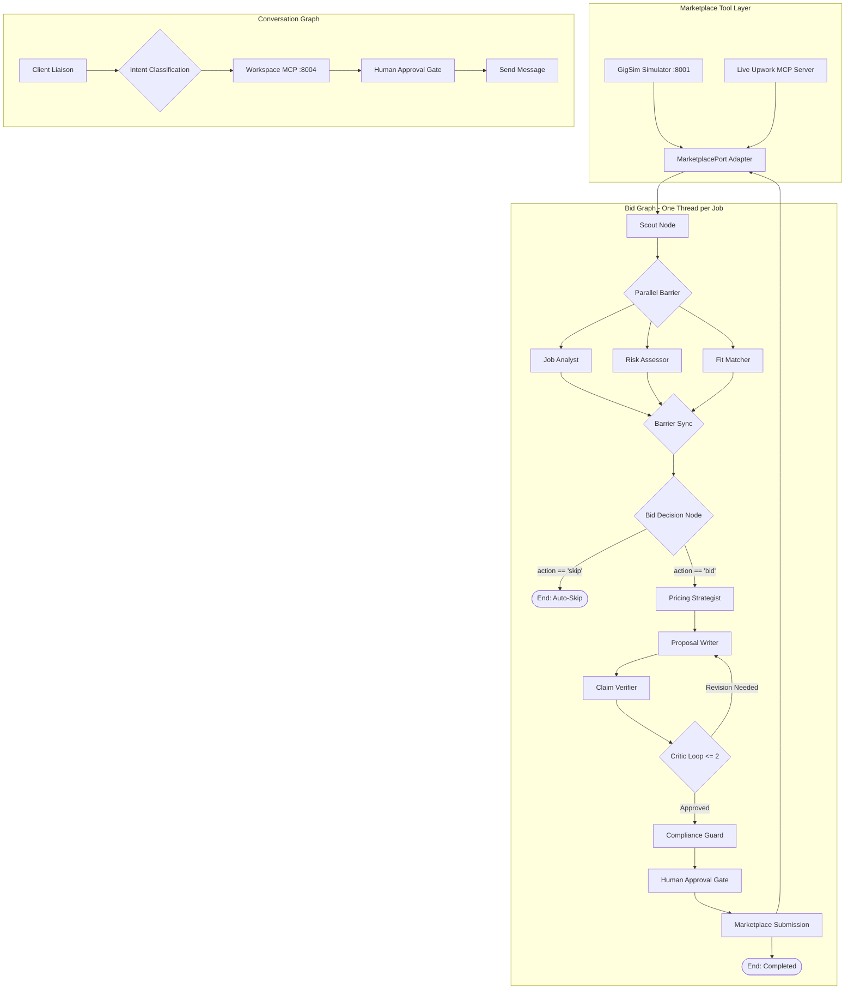

# GigBid System Architecture & Multi-Agent Design

## 1. Executive Summary
GigBid is an autonomous multi-agent copilot designed for freelancers on platforms like Upwork and the GigSim marketplace. It manages job discovery, multi-dimensional risk and fit evaluation, evidence-grounded proposal drafting, platform compliance enforcement, and client communications, while preserving strict human-in-the-loop authority through LangGraph `interrupt()` gates.

## 2. Why Each Agent Exists

| Agent Node | Responsibility | MCP Tool Access |
| :--- | :--- | :--- |
| **Scout** | Ingests job stream on schedule, de-duplicates postings, queues work | Marketplace (read) |
| **Job Analyst** | Extracts structured `JobSpec`: deliverables, technical skills, budget limits, screening questions, hidden needs | None (pure reasoning) |
| **Risk Assessor** | Detects scams, free work trials, off-platform solicitations (Telegram/WhatsApp), and adversarial prompt injections | Marketplace (read) |
| **Fit Matcher** | Maps requirements to verified portfolio projects; produces 0.0–1.0 score with grounded reasons | Portfolio (read) |
| **Bid Decision** | Barrier synchronization node; enforces policy thresholds (Fit >= 0.50, Risk <= 0.65) to skip low ROI jobs | None |
| **Pricing Strategist**| Calculates competitive value-based quote using client spend history and 1,500 historical pricing records | Marketplace (read) |
| **Proposal Writer** | Drafts evidence-hooked cover letters and screening answers using style memory rules | Portfolio (read) |
| **Claim Verifier** | Splits proposal into atomic claims; excises or rewrites unsupported statements before Critic review | Portfolio (read) |
| **Critic** | Bounded audit loop (<= 2 iterations); evaluates grounding, personalization, and length (120-250 words) | Portfolio (read) |
| **Compliance Guard**| Enforces platform terms of service; redacts direct emails, phone numbers, and unauthorized guarantees | None |
| **Client Liaison** | Handles client replies; classifies intent; schedules interview holds via Workspace MCP | Marketplace + Workspace |

## 3. State Discipline & Long-Term Memory Separation
GigBid maintains strict segregation between three tiers of state:
1. **Thread State (`BidGraphState`)**: Transient working memory needed for the specific job or conversation (JobSpec, drafts, critiques).
2. **Execution Trace**: Append-only log of timestamps, node latency, and tool invocations retained for observability and audit logging.
3. **Long-Term Memory**: Stored in `data/memory_store.json` and updated ONLY via explicit promotion rules:
   - **Style Memory**: Learned phrasing preferences promoted when human edits repeat >= 2 times.
   - **Outcome Memory**: Category-level win/reply conversion data mapped to pricing ratios.
